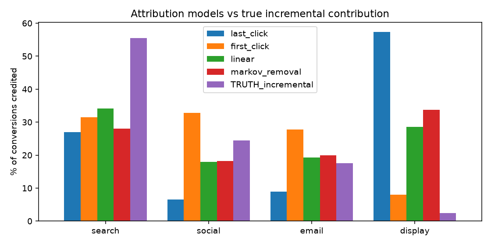

# Marketing attribution and incrementality

**Synthetic data, real method.** Everything is simulated with fixed seeds in `analysis.py`; no employer data. Because the simulation
knows each channel's *true* causal effect, every method can be graded instead of just trusted.

## Questions
1. Do last-click, first-click, linear and data-driven (Markov removal effect) attribution tell us where conversions really come from?
2. Does a geo-holdout test recover a known lift when a simple before/after comparison cannot?
3. Can a small marketing-mix model recover channel effects from weekly spend alone?

## 1. Attribution vs ground truth (40,000 users, intent confounds exposure)
High-intent users are more likely to be searched and retargeted, so rules that reward the final touch over-credit those channels.
Display has almost no true effect but is mostly shown last (retargeting).

Share of conversions credited, %:

| channel | last_click | first_click | linear | markov_removal | TRUTH_incremental |
|---|---|---|---|---|---|
| search | 27.0 | 31.4 | 34.2 | 28.1 | 55.6 |
| social | 6.6 | 32.8 | 18.0 | 18.2 | 24.4 |
| email | 9.0 | 27.8 | 19.3 | 19.9 | 17.6 |
| display | 57.4 | 8.0 | 28.5 | 33.8 | 2.4 |

Total share misallocated versus truth (percentage points): last-click **55.0**, first-click **24.1**,
linear **27.8**, Markov removal **33.7**.
Takeaway: every path-based rule misallocates credit, and which one looks best depends on assumptions about touch order, so none of them can be trusted for budget decisions. Last-click is the worst here because it hands most credit to display retargeting, which has almost no true effect. Use them for reporting and calibrate budget decisions with experiments (section 2).

## 2. Geo-holdout incrementality test (60 geos, 12 pre weeks + 4 test weeks, half randomized to treatment)
True lift built into the simulation: **+4%**.
- Naive before/after on treated geos: **+0.4%** (contaminated by the shared seasonal trend).
- Difference-in-differences vs holdout geos: **+3.9%**, permutation 95% interval [-1.7%, +1.8%], p = 0.000.
Randomizing geos and comparing against a holdout removes the trend that a before/after comparison cannot.

## 3. Marketing-mix model (104 weeks, adstock + saturation, ridge regression)
In-sample R^2 0.96. True vs estimated channel effects (conversions at saturation), with 90% bootstrap intervals:

| channel | true_effect | estimated | ci90_low | ci90_high |
|---|---|---|---|---|
| search | 900 | 921 | 857 | 983 |
| social | 700 | 671 | 582 | 775 |
| email | 250 | 179 | 82 | 271 |
| display | 40 | -45 | -158 | 76 |

## Caveats I would raise on a real engagement
- Attribution and MMM need to be calibrated with experiments (like section 2); neither is a causal estimate on its own.
- The MMM here is given the true adstock and saturation form. On real data those must be estimated, and weekly data with correlated
  spend gives much wider intervals.
- A holdout test measures one channel at one spend level; extrapolating beyond it needs more cells.

## Run it
`pip install numpy pandas scikit-learn matplotlib` then `python analysis.py`.
